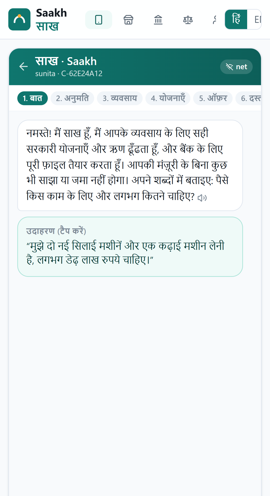
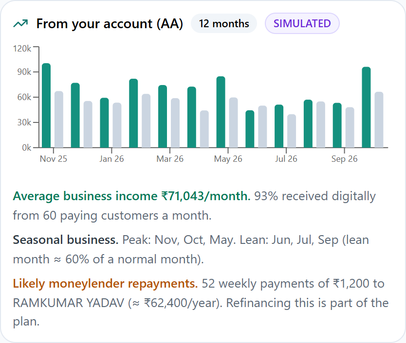
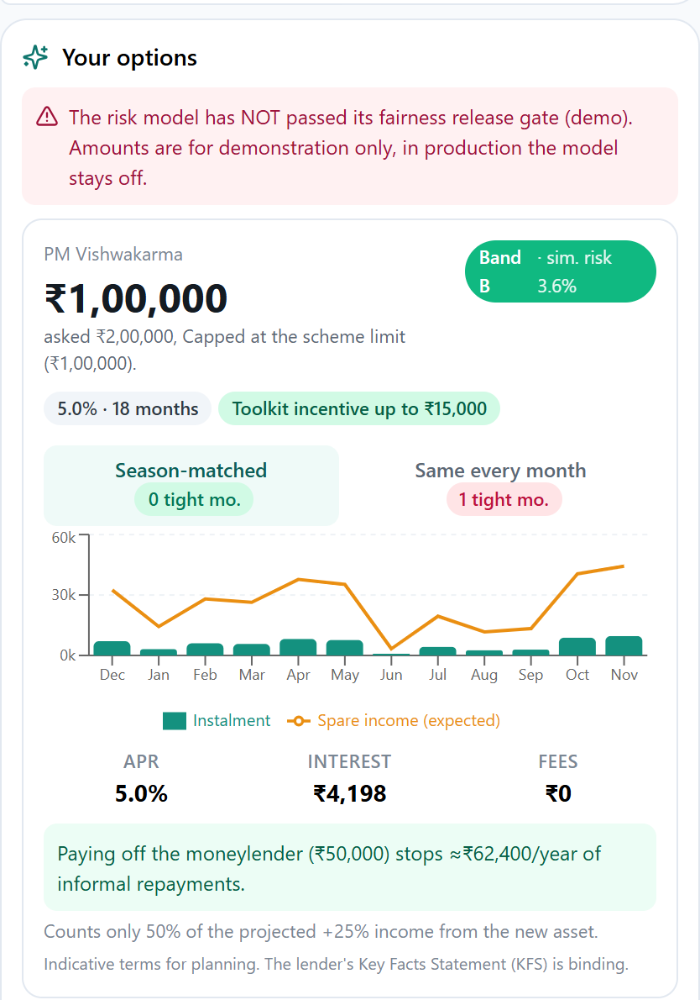
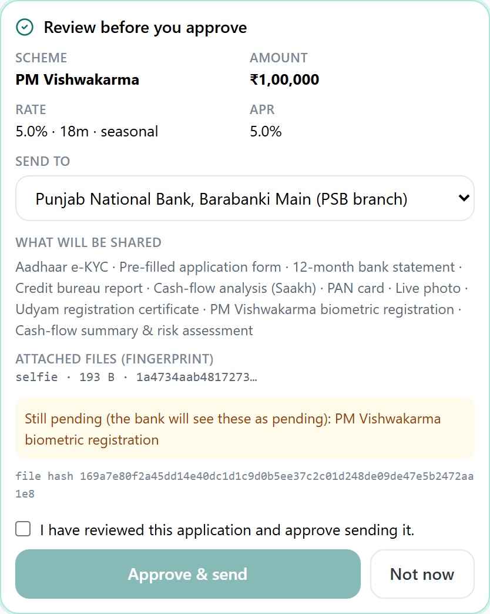
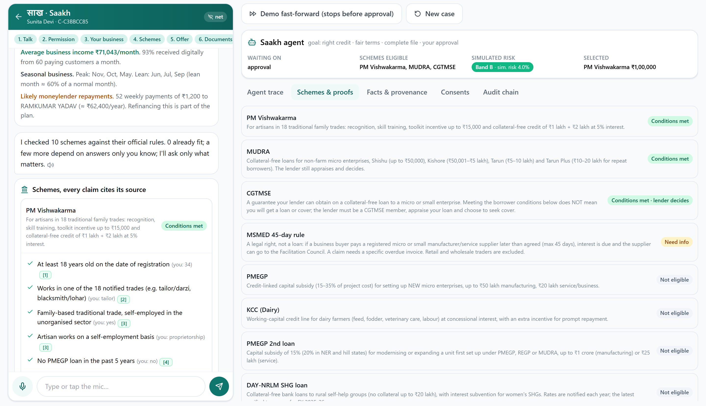
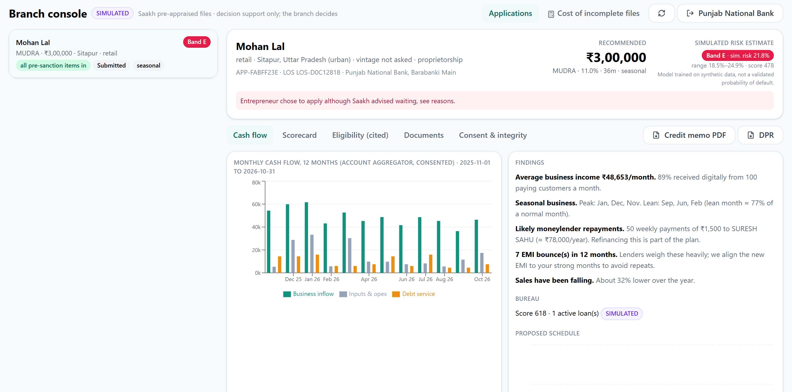

# Saakh (साख): an agentic credit & schemes copilot for India's invisible MSMEs

**Tech4Bharat 2026 · Theme 3 MSME Finance & Compliance · Problem 3.2 "Formal credit and schemes" · Agentic AI**

*Saakh* means creditworthiness: the trust a business has earned. Tailors, fabricators, dairy units and SHG enterprises earn that trust every day in UPI flows that no bank form recognises. Saakh is an agent that turns those consented flows into **bank-ready credit**. It finds the schemes whose conditions the business meets, citing a source for every claim and separating what the scheme requires from what the lender still decides. It sizes a loan the business can repay in its lean months. It assembles a lender-ready file that lists anything still pending, and nothing leaves the phone until the entrepreneur approves **that exact file**.

> All people, statements and bureau records are synthetic. Account Aggregator, DigiLocker, credit bureau, Udyam, PM SVANidhi and lender systems are **simulated adapters** with production-shaped interfaces. The UI labels every one of them **SIMULATED**.

---

## What it does, end to end (≈2 minutes per entrepreneur)

| Step | What the agent does | What makes it different |
|---|---|---|
| **Talk** | Understands *"मुझे दो सिलाई मशीनें चाहिए, डेढ़ लाख"* by voice or text, in Hindi, Hinglish or English | Offline Hindi/Hinglish parser, deterministic and testable; every parsed value is validated against the fact registry |
| **Permission** | Requests 4 **separate, purpose-bound consent artefacts** (ReBIT-style): DigiLocker, AA statement, bureau, Udyam | Optional ones can be declined; the agent then falls back to asking |
| **Fetch** | Calls the simulated AA. The first call times out by design; the agent **retries with backoff** and recovers | Every tool call passes a **code-level guard** first |
| **Understand** | Categorises up to 12 months of transactions and says how many it actually read (a shorter upload is flagged everywhere, including the DPR). Detects moneylender repayments (e.g. ₹1,200 every Monday ≈ **57% p.a.**), bounces, seasonality and B2B buyers | AA transactions are processed in memory, not stored. An **uploaded** CSV statement *is* stored (in SQLite, unencrypted in this demo) only while its consent is active; it is deleted on revocation or expiry |
| **Schemes** | Evaluates 10 scheme pathways with a **three-valued, cited rule engine**. Each criterion carries a source and a verification status, and the engine keeps eligibility, availability and lender checks separate. Stand-Up India shows as *not available* (period ended March 2025; a successor is announced but not yet running) | The rules are YAML; the loader **refuses uncited rules, lender checks and caveats** |
| **Unlock** | Notices that free Udyam registration meets a condition for CGTMSE and offers to do it (simulated, classified from declared investment *and* turnover). It says plainly that CGTMSE cover is the lender's decision | Counterfactuals only over *actions*, never over who you are |
| **Ask** | Asks only the questions whose answers change an outcome, ranked by **value of information** (₹-weighted) | Sensitive questions are discounted and optional |
| **Offer** | Scores a **simulated risk estimate** with a calibrated, fairness-audited scorecard (trained on synthetic data; its release gate is BLOCKED, so production mode refuses score-based offers and the demo labels every offer) and sizes the loan from disposable cash flow and risk policy. Builds a **season-matched repayment schedule** (same PV, small instalments in lean months) and a KFS-style APR | Dairy case: flat EMI would leave 12 of 36 months tight; season-matched leaves **0** |
| **Documents** | Solves a **minimum-effort set cover**: 17 typical papers → 9 items, mostly auto-fetched or generated (DPR, cash-flow analysis, pre-filled form). Uploads are real: type-checked by content, size-limited and SHA-256 fingerprinted. Saakh does not read them; the lender verifies them | Offline steps can be routed to a **JanAI Café** |
| **Approve** | Shows exactly what is shared, with whom, at what APR, which items are still pending, and the fingerprint of every attached file. Approval is **bound to the file's SHA-256, which covers each attachment's SHA-256**; replacing a document or correcting a fact voids it (and supersedes an already-sent copy until re-approved) | Assisted mode requires a one-time code from the entrepreneur's phone, for consents, statement upload and approval |
| **Submit & track** | Submits to the lender's LOS (simulated). The branch (with its key) sees a credit memo, reason codes, cited eligibility and integrity proofs | Revoking consent withdraws the file and erases its contents from the lender copy |

## Results on the synthetic population (simulator outputs, not real-world performance)

The labels are drawn from a hand-specified generator, so these numbers show that the *pipeline* works. They are not evidence about real borrowers. Feature gates ran on a validation split; the test split (n = 6,000) was used once.

| | Saakh scorecard | Traditional checklist (ITR + collateral + vintage + no bounces) |
|---|---|---|
| Creditworthy borrowers reached | **76.3%** | 6.1% |
| Default rate among approved | **5.0%** | 7.2% |
| Women ÷ men approval ratio (AIR) | **0.985** (95% CI 0.95–1.00) | 0.19 |
| Rural ÷ urban approval ratio | **0.999** (95% CI 0.97–1.00) | 0.73 |

AUC 0.736 (95% CI 0.714–0.759) · PR-AUC 0.199 · Brier 0.073 · log loss 0.263 · ECE 0.61% · gradient-boosting challenger AUC 0.735, so the points table gives up essentially no accuracy.

**One fairness gate fails, and the model is marked BLOCKED.** Seven group pairs are gated (gender, rural/urban, both combined, SC/ST/OBC vs General, and the most different zones). The ST vs General opportunity gap on the test split is −7.3 pp (95% CI −11.9 to −3.4), beyond the 5 pp gate. Training re-measured it automatically on a fresh draw of 20,000 and got −1.85 pp. The simulator gives caste no effect at all, so this is most likely sampling noise in a ~550-person subgroup. The rule still fails closed, so on real data this model would not ship until the gap was investigated. The gates also rejected "business size" (no AUC gain, doubles the rural opportunity gap) and removed "payer diversity" (a weak proxy for rural location). See [docs/MODEL_CARD.md](docs/MODEL_CARD.md).

## See it

**Live demo:** https://saakh.onrender.com (free hosting: the first visit after a quiet spell takes about a minute to wake up; all data is synthetic)

**Submission:** [presentation deck (PDF)](submission/Saakh_Tech4Bharat_2026.pdf) · [PowerPoint](submission/Saakh_Tech4Bharat_2026.pptx) · [form text](submission/SUBMISSION.md)

| The owner's view | Cash flow, read from the statement |
|---|---|
|  |  |
| **A loan matched to the seasons** | **Exact-file approval** |
|  |  |




## Run it

```powershell
.\run.ps1          # Windows: venv + deps + (train) + build UI + serve
```
```bash
./run.sh           # macOS / Linux / Git Bash
```
Then open **http://127.0.0.1:8000**. This is a **demo build** (`SAAKH_ENV=demo`, the default): it seeds four synthetic applications, offers a fast-forward that always stops *before* approval, and offers per-branch demo keys (`demo-<lender-id>`, chosen from a list on the sign-in screen) and the assisted-mode code (as a simulated SMS) on screen. `SAAKH_ENV` must be `demo` or `production`; anything else refuses to start. With `SAAKH_ENV=production` the demo routes are gone, and the server refuses to start unless `SAAKH_SIGNING_KEY` and `SAAKH_LENDER_KEYS` (`lender-id:key,…`, one key per branch) are set to non-demo values that pass a strength check (generate them with `python -c "import secrets; print(secrets.token_urlsafe(32))"`; `SAAKH_SIGNING_KEYS_PREVIOUS` keeps old signing keys valid for verification during a rotation). Expired consents are cleaned up by a background sweep every `SAAKH_EXPIRY_SWEEP_SECONDS` (default 300); the shipped run scripts start one worker. With several workers, set `SAAKH_EXTERNAL_SWEEP=1` and run `python -m saakh.sweep` from cron; case writes are revision-checked, so a concurrent save is rejected (409) instead of silently overwritten. Tests: `.\run.ps1 -Test` or `./run.sh test` (126 tests: rules, analytics, model protocol, guardrails, strict event schemas, one-time codes, auth, lender isolation, frozen lender views, lender-decision state and idempotency, uploads, consent expiry and revocation, audit minimisation, concurrency, submission recovery across a process restart, every persona end-to-end). The 33 HTTP tests use Starlette's `TestClient`, which needs loopback sockets; in a sandbox that blocks them, run `python -m pytest -m "not api"` (93 tests), CI on Ubuntu runs the full suite.

Requirements: Python ≥ 3.11 and Node ≥ 18. The ML stack is numpy/scipy only. scikit-learn's compiled DLLs are blocked by Windows Smart App Control on the build machine, so the few primitives needed live in `backend/saakh/risk/ml.py`.


## Tour (screens)

- **Entrepreneur** (Hindi default; voice input and read-aloud on every message; offline queue toggle): six personas, a live agent trace, scheme proofs, facts with provenance, consents with *Revoke*, and the audit chain.
- **JanAI Café**: the same journey in assisted mode; consent, statement upload and approval each need their own one-time code from the entrepreneur's phone. A code works once, for that step only, and expires after 10 minutes; Saakh stores only a keyed hash of it. Five wrong codes void it and lock entry for 15 minutes, and 15 wrong codes disable entry for the case. No SMS provider is integrated, so the code is shown on screen in demo builds and production builds do not offer assisted mode.
- **Branch** (one key per branch; a branch sees only files addressed to it, and only while their sharing consent is active): queue with honest completeness (items to be done at a café count as pending) → credit memo (cash flow with its real coverage, scorecard points, cited eligibility, documents with fingerprint-verified downloads, integrity checks) → sanction / query / decline; PDF memo and DPR; *Cost of incomplete files* calculator. Every view and download is written to the entrepreneur's audit log.
- **Governance**: the release decision and gate results with confidence intervals, fairness vs. the traditional rule, reliability curves within groups, feature-gate decisions, proxy audit, the full points table, the scheme rule base with source verification.
- **Federation**: screens 40 SHG members against every scheme in seconds (profile-only, no financial data).

A five-minute demo script is in [docs/DEMO_SCRIPT.md](docs/DEMO_SCRIPT.md).

## Repository map

```
backend/saakh/
  facts.py                 fact registry: types, questions (en/hi), why-we-ask, priors, actions
  schemes/kb/*.yaml        9 schemes as cited rules · sources.yaml (verification status per source)
  schemes/engine.py        3-valued evaluation, proof trees, counterfactual unlocks, KB validation
  schemes/questions.py     value-of-information question planner
  schemes/benefits.py      cited benefit math (PMEGP subsidy, CGTMSE fee slabs, MUDRA category…)
  cashflow/                categorisation · informal-debt detection · features · season-matched sizing · APR
  risk/                    synthetic population · monotone WoE scorecard · training with fairness/proxy gates
  consent.py · store.py    ReBIT-style signed artefacts · SQLite with hash-chained audit log
  agent/                   runtime (planner, checkpoints, recovery) · tools + guard · Hindi NLU
  docs/                    document set-cover planner · DPR & credit-memo PDFs
  api/main.py              FastAPI + static UI
frontend/src/              React + TypeScript + Tailwind PWA (entrepreneur, café, branch, governance, federation)
docs/                      architecture · decisions · model card · business · field research · demo script
```

## Documentation

- [docs/REVIEW_RESPONSE.md](docs/REVIEW_RESPONSE.md): each point of the external review, verified, fixed and tested
- [docs/ARCHITECTURE.md](docs/ARCHITECTURE.md): components, agent loop, guardrails, data flow
- [docs/DECISIONS.md](docs/DECISIONS.md): design decisions and the alternatives rejected
- [docs/MODEL_CARD.md](docs/MODEL_CARD.md): risk model, calibration, fairness, limits
- [docs/BUSINESS.md](docs/BUSINESS.md): who pays, unit economics, scale, jobs
- [docs/FIELD_RESEARCH.md](docs/FIELD_RESEARCH.md): the organisers' six questions turned into testable hypotheses
- [docs/DEMO_SCRIPT.md](docs/DEMO_SCRIPT.md): five-minute walkthrough
